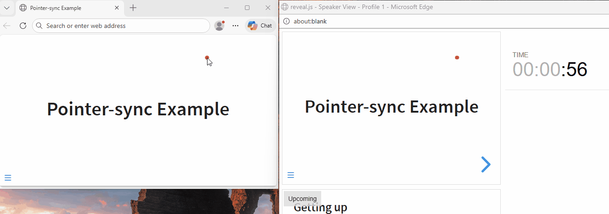

# Pointer-sync Extension For Quarto

This is a simple pointer plugin that synchronizes the pointer between the speaker view and the main window.



## Installing

```bash
quarto add herosi/pointer-sync
```

This will install the extension under the `_extensions` subdirectory.
If you're using version control, you will want to check in this directory.

## Using

1. Include this plugin as shown below in the front matter of a qmd or `_quarto.yaml`.

   ``` yaml
   revealjs-plugins:
     - pointer-sync
   ```

2. Open an HTML that quarto rendered with this plugin.
3. Use the keys below.

| Action | Windows / Linux | macOS |
| --- | --- | --- |
| Open the speaker view | `S` | `S` |
| Show the pointer (hold while moving the mouse) | `Ctrl` | `⌘ Cmd` |
| Enable / disable the pointer | `Alt` + `P` | `⌥ Option` + `P` |

## Example

Here is the source code for a minimal example: [example.qmd](example.qmd). View an example presentation at [example.html](https://herosi.github.io/pointer-sync/demo/example.html). Hold 'Ctrl' ('⌘ Cmd' on macOS) to display the pointer.

