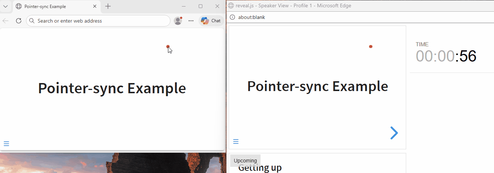

## Description

This is a simple pointer plugin that synchronizes the pointer between the speaker view and the main window.



## Usage

1. Add this plugin to the front matter of a `.qmd` file or `_quarto.yaml`, as shown below.

   ``` yaml
   revealjs-plugins:
     - pointer-sync
   ```

2. Open an HTML that quarto rendered with this plugin.
3. Use the keys on the next slide.

## Keys {.smaller}

| Action | Windows / Linux | macOS |
| --- | --- | --- |
| Open the speaker view | `S` | `S` |
| Show the pointer (hold while moving the mouse) | `Ctrl` | `⌘ Cmd` |
| Enable / disable the pointer | `Alt` + `P` | `⌥ Option` + `P` |
